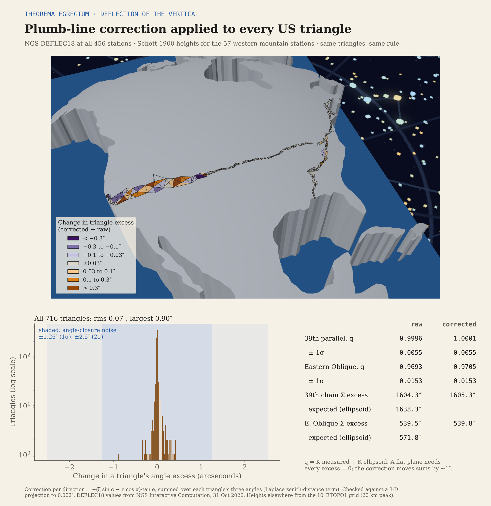

# Deflection of the vertical in the US triangulation chains

**Page:** https://rooster-ninja.github.io/simulations/deflection-chains/

## What it shows

A theodolite's horizontal circle is levelled to the local plumb line, which leans away from the ellipsoid normal by the deflection of the vertical (ξ north–south, η east–west). This page puts that correction into every observed angle of the two US chains used in the [Theorema Egregium report](https://rooster-ninja.github.io/TheoremaEgregium_CurvatureMeasuredFromSurveyorsTriangles/): the arc of the 39th parallel (Schott 1900) and the Eastern Oblique Arc (Schott 1902). It then measures the curvature again from the same triangles under the report's declared rule, and draws the chains on the report's curvature dome, coloured by how much each triangle's excess moved.

## Result

| | Raw angles | Corrected (DEFLEC18) |
| --- | ---: | ---: |
| Change per triangle, 716 triangles | — | rms 0.07″, largest 0.90″ |
| US 39th parallel, q = K / K ellipsoid | 0.9996 ± 0.0055 | 1.0001 ± 0.0055 |
| US Eastern Oblique, q | 0.9693 ± 0.0153 | 0.9705 ± 0.0153 |
| 39th parallel chain sum (241 triangles) | 1 604.3″ | 1 605.3″ (expected 1 638.3″, noise ±19.6″) |
| Eastern Oblique chain sum (114 triangles) | 539.5″ | 539.8″ (expected 571.8″, noise ±14.9″) |

The correction moves q by under 0.1σ in both chains. It is far smaller than one triangle's angle-closure noise (±1.26″ to ±1.40″) and cannot bring any excess near zero. It does not explain the Eastern Oblique shortfall. These are inductive findings with the stated inputs, good to the error bars shown.

## How it works

For a direction at azimuth α to a station seen at elevation angle e, the reduction to the ellipsoid normal is

    δ = −(ξ sin α − η cos α) · tan e

(the zenith-distance term of the Laplace azimuth equation). An angle changes by the difference of its two directions' δ, and a triangle's excess by the sum over its three corners. `scripts/check_formula.py` checks this against a full 3-D projection onto the tilted horizon: agreement to 0.002″.

## Inputs and errors

- **Deflections:** NGS DEFLEC18 at all 456 station positions (Interactive Computation, file input, Format 2, longitude positive west), run 31 Oct 2026. Raw input and output in `sources/`.
- **Heights:** Schott's adjusted heights for 57 stations west of 100° W, transcribed from Schott 1900 pp. 256–341 (`sources/schott1900_station_heights.csv`; OCR'd values, page cited per row). Elsewhere the highest ETOPO1 10′ value within 20 km.
- **Refraction:** k = 0.13 in the elevation angle; rerunning with 0.05 and 0.20 changes no triangle by more than 0.05″.
- **Brackets:** grid heights at the station instead of the 20 km peak; EIGEN-6C4 geoid slope (degree 720) instead of DEFLEC18. Both are shown on the page.
- **Fit:** the report's rule unchanged (SNR ≥ 2, tier weights, per-survey σ, √(χ²/dof) inflation).

## Simplifications

- DEFLEC18 is today's modelled deflection at the printed positions, not an observation at the marks.
- Eastern heights come from a smoothed grid; those sight lines are nearly level, so their δ is small either way.
- Lateral refraction is not modelled.

## Model

`model/` is a copy of the report's `model/` folder (North America on a sphere of the measured K = 2.450 × 10⁻¹⁴ m⁻², 1 mm = 1 km). Added here:

- `chain_overlay_dov.py` rebuilds the chain overlay coloured by the change in excess: seven bins from < −0.3″ to > 0.3″ (PuOr; grey = ±0.03″).
- `dov_bodies/` holds one STL per colour step plus the outlines, for SolidCraft.
- `viewer_scene_dov.glb` is the land and ocean of `viewer_scene.glb` with the recoloured chains, used by this page's viewer.
- `overlay_dov.json` lists the bins, colours and counts.

## Files

| Path | What |
| --- | --- |
| `index.html` | The page (built by `scripts/build_page.py`) |
| `scripts/dov_correct.py` | Deflections, heights, per-triangle corrections, refits |
| `scripts/check_formula.py` | Independent 3-D check of the correction |
| `scripts/figure_dov.py` | The summary figure |
| `data/dov_triangles.csv` | Per triangle: raw excess, change (main and brackets), corrected excess |
| `data/dov_stations.csv` | Per station: ξ, η (DEFLEC18 and EIGEN-6C4), heights |
| `data/dov_results.json` | Fits and chain sums |
| `data/*.nc` | EIGEN-6C4 geoid and ETOPO1 grids, 10′ (Fatiando a Terra data) |
| `figures/` | Summary figure and dome renders |

## Sources

- National Geodetic Survey, DEFLEC18 (companion to GEOID18), Interactive Computation.
- Schott, C. A., *The Transcontinental Triangulation and the American Arc of the Parallel*, USC&GS Special Publication No. 4, 1900 (heights pp. 256–341; deflections in angle measures, p. 206; large astronomic deflections, p. 848).
- Schott, C. A., *The Eastern Oblique Arc of the United States and Osculating Spheroid*, USC&GS Special Publication No. 7, 1902.
- The Theorema Egregium report's `triangles_rule.csv`, `chain_results.json`, `arcs_parallel_master.kml` and model.
- EIGEN-6C4 and ETOPO1 via the ICGEM Calculation Service and Fatiando a Terra data.
