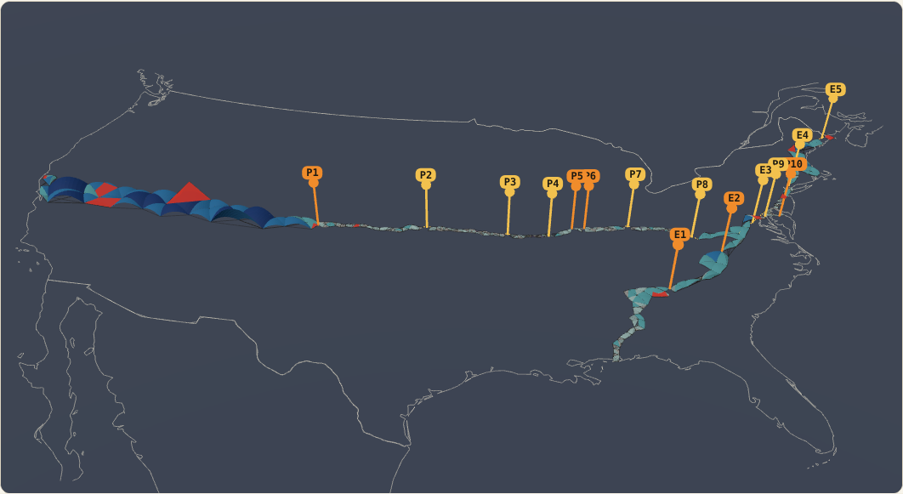

# Flat plane, lumpy triangles

**Page:** https://rooster-ninja.github.io/simulations/flat-plane-chains/

## What it shows

The 39th-parallel and Eastern Oblique triangulation chains (Schott 1900, 1902) laid on a flat map of North America with no curve fitted under them. Each triangle is tested on its own against a flat triangle: do its three observed angles add up to 180°? Its measured excess is drawn as a lump over its own footprint. Triangles with an angle that was never observed (printed "…." in Schott's tables) are red and untested. Every place a chain breaks is pinned.

## How it works

1. **Observed excess** = the three station-adjusted angles printed by Schott, before the network adjustment, minus 180°. A flat triangle gives 0.
2. **Noise** = the survey's closure noise per triangle from the report's rule: ±1.261″ (39th parallel), ±1.397″ (Eastern Oblique).
3. **Test** z = observed excess ÷ noise. On a flat plane z scatters around 0 with spread 1.
4. **Own radius** √(area / observed excess): what that one triangle implies, with no other triangle involved.
5. **Lump**: the piece of a sphere of that triangle's own radius passing through its three corners, height (r² − d²) / 2R above the plane (r circumradius, d distance from the circumcentre). Triangles with the same radius show the same curvature at any size. Triangles under 3σ are faded. Display only.
6. **Unresolved:** no observed excess in the report's table (an angle printed "….") → not tested, drawn red, no lump.
7. **Breaks:** segments are groups of triangles joined by shared printed sides. Neighbouring segments are linked by the closest station pair (minimum spanning tree): a link through one shared station is a "single shared station" join, otherwise a gap.

The flat layout is an azimuthal equidistant map of the printed station positions (centre 39° N 92° W). It is for display only: no number is computed from it.

## Result

| | 39th parallel | Eastern Oblique |
| --- | ---: | ---: |
| Triangles | 465 | 281 |
| Tested (all three angles observed) | 449 | 267 |
| Unresolved (angle not observed) | 16 | 14 |
| Positive / negative excess | 382 / 67 | 246 / 21 |
| More than 3σ above a flat triangle | 108 | 112 |
| Chain tiles (non-overlapping) | 241 | 114 |
| Σ observed excess over tiles | 1 604.3″ ± 19.6″ | 539.5″ ± 14.9″ |
| σ above flat | 82 | 36 |
| Σ ellipsoid excess (comparison only) | 1 638.3″ | 571.8″ |
| Segments | 11 | 6 |
| Segments with unresolved removed | 11 | 6 |

- **No break is caused by an unresolved triangle.** Each sits inside a net whose resolved triangles still join each other by shared sides around it. They are holes in the test, not cuts in the chain. None is a chain tile, so filtering them leaves the chain sums unchanged.
- **The chains break in 15 other places** in this transcription: 6 joins pass through a single shared station with no shared side (P1 Big Springs, P5 Mound, P6 Hunt City, P10 Kent, E1 Grassy, E2 Buffalo), and 9 are gaps of 11 to 283 km where no triangle in the data set joins the two parts. Gaps may be sections the report did not transcribe rather than gaps in Schott's network; `data/chain_breaks.csv` lists them for checking against the printed tables.
- Every segment's tile sum is positive. The 88 negative triangles are all under 747 km² and none is below −3.0σ.

These are inductive findings from Schott's printed angles with the stated noise, good to the error bars shown.

## What a flat plane predicts

Each triangle's excess is its own total curvature and nothing more; its own radius is that curvature restated in kilometres. How the curvature is spread inside a triangle the angles cannot say, so each lump is drawn from its own triangle's numbers only.

A theodolite is levelled square to the plumb line. If all plumb lines are parallel (a flat plane), every station's horizontal plane is parallel, and each measured angle equals the angle of the stations projected straight down onto one plane. Every triangle's angles then sum to exactly 180°, whatever the terrain: heights and lumps drop out. The flat prediction is excess 0 ± noise for every triangle. Triangle 32 (Nebo–Tushar–Wheeler Peak) is 75″ over against ±1.3″, which requires the stations' plumb lines to be turned relative to each other.

## Error budget

| Source | Size | Effect |
| --- | --- | --- |
| Angle-closure noise | ±1.261″ / ±1.397″ per triangle | the σ in every z |
| Deflection of the vertical | rms 0.07″, max 0.90″ | far below the noise ([deflection-chains](../deflection-chains/)) |
| Area from printed sides | parts per 10⁵ | own radius only |
| Transcription | 3 degree misprints corrected | report qc column |
| Display map | azimuthal equidistant | none (drawn, not used) |

## Files

| Path | What |
| --- | --- |
| `index.html` | The page (built by `scripts/build_page.py`) |
| `scripts/build_flat.py` | Per-triangle flat test, segments, breaks, chain re-run |
| `scripts/build_page.py` | Writes `index.html` from `data/flat_chains.json` |
| `data/flat_chains.json` | Everything the viewer draws |
| `data/flat_triangles.csv` | Per triangle: status, segment, observed excess, z vs flat, own radius, lump height |
| `data/chain_segments.csv` | Per segment: tiles, sums, noise, σ above flat |
| `data/chain_breaks.csv` | Breaks: kind, stations, gap, position |
| `sources/triangles_rule.csv`, `sources/chain_results.json` | Copies from the Theorema Egregium report |
| `sources/us_triangle_vertices.csv` | Station positions per triangle, from the report's master KML |
| `sources/na_outline_lonlat.json` | Natural Earth 1:50m outline (US, Canada, Mexico) |

Rebuild: `python3 scripts/build_flat.py && python3 scripts/build_page.py`.

## Sources

- C. A. Schott, *The Transcontinental Triangulation and the American Arc of the Parallel*, USC&GS Special Publication No. 4 (1900). Part III (d), pp. 588–591 (observed angles, corrections, spherical excess; unobserved angles printed "…."); Part III §H, p. 613 (closing errors).
- C. A. Schott, *The Eastern Oblique Arc of the United States and Osculating Spheroid*, USC&GS Special Publication No. 7 (1902).
- [Theorema Egregium: curvature measured from surveyors' triangles](https://rooster-ninja.github.io/TheoremaEgregium_CurvatureMeasuredFromSurveyorsTriangles/): `triangles_rule.csv`, `chain_results.json`, master KML.
- Natural Earth 1:50m admin-0 countries (public domain).
