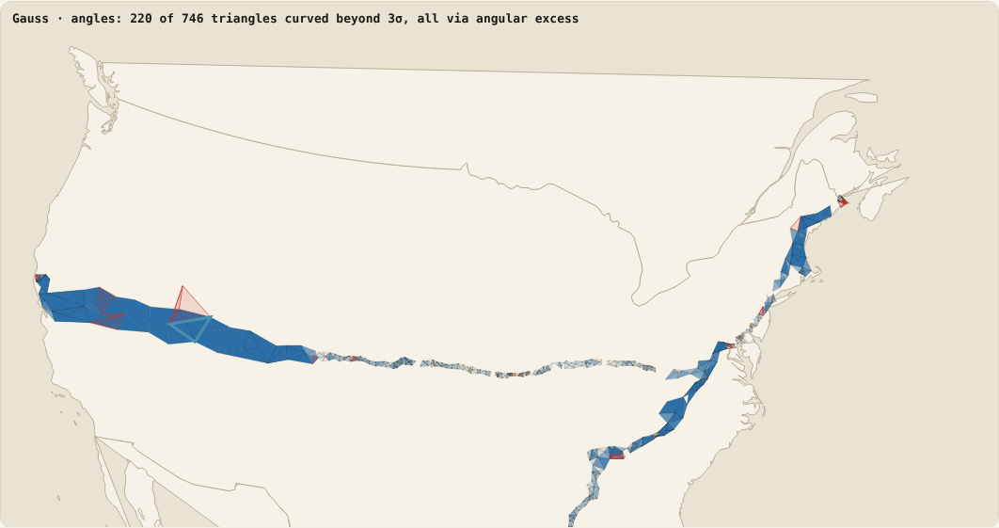
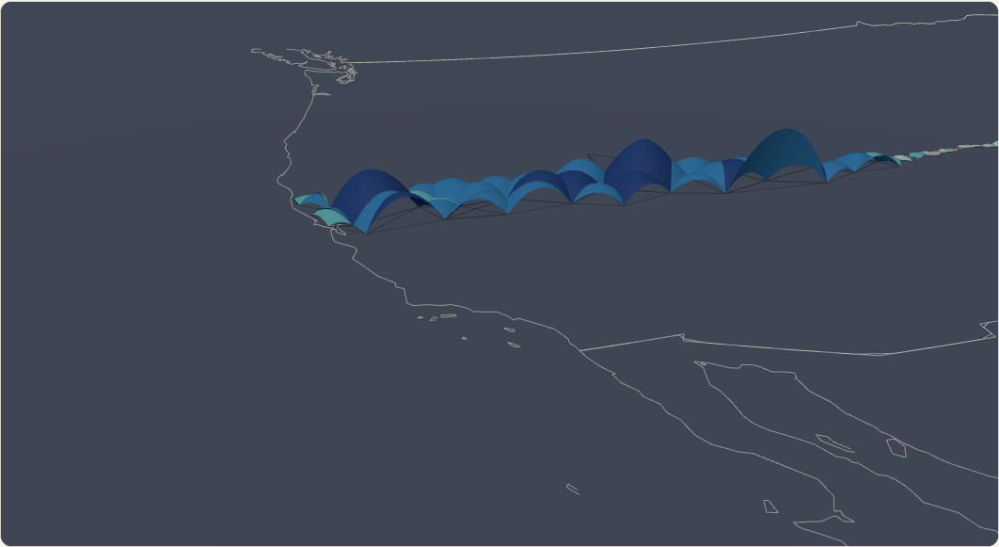

# Survey triangles across America: Gauss vs Tarski

**Page:** https://rooster-ninja.github.io/simulations/survey-triangles-gauss-vs-tarski/

## What it shows

- **Gauss curves in 3D.** Each tested triangle drawn as the piece of a sphere of its own radius √(area / observed excess) through its three corners, coloured by σ above flat, with a height slider. Nothing joins one triangle's curve to the next. Switching to the Tarski reading settles every curve flat.

Every triangle of Schott's 39th-parallel arc (465) and Eastern Oblique arc (281) is read two ways.

- **Gauss reading (angles).** Excess ε = sum of observed angles − 180°, tested against closure noise. 220 triangles are curved beyond 3σ. Every one gets its curvature through angular excess. That route exits the Theorema Egregium (Art. 12, curvature from lengths E, F, G) for Art. 20 (angle excess = integral curvature, stated through the normals), and it rests on plumb-levelled angles and on sight lines treated as shortest lines.
- **Tarski reading (lengths).** Only the three printed sides of each triangle are used, decided as plane geometry (Tarski: elementary plane geometry is complete and decidable). All 746 triangles exist as flat triangles, and their plane angles sum to 180° exactly.
- **Closed fans (lengths).** A station ringed by triangles is the one place lengths alone can show curvature. 62 fans were found. Each fails to close flat by its sides alone, with deficits of 0.3″ to 90.8″. But each deficit equals one third of the fan's printed ellipsoid excess, to +0.05″ ± 0.31″. That is the ε/3 that Legendre's theorem took off each angle to compute the sides. The curvature in the lengths was put there from the angles and the ellipsoid model; it was not measured. So the fans add no information of their own: at face value they read curved, but as a lengths-only test they cannot tell flat from curved. A fan with every side measured would decide it: deficit 0 within error bars means flat, above them means curved.

## The presumed Earth radius

Schott's printed excess was computed, not measured: ε = ab sin C / (2ρmρn sin 1″), with ρm, ρn the radii of curvature of Clarke's 1866 spheroid (SP4 pp. 47, 51; SP7 p. 26), a mean radius of about 6 374 km at 39° N. Turning the printed excess back into a radius, √(area / ε), gives a median of 6 373 km (39th parallel) and 6 372 km (Eastern Oblique). That presumed radius enters the printed excess, every computed side (each angle reduced by ε/3), Schott's closing errors (π + spherical excess − sum of angles, SP4 p. 612), and therefore every closed-fan deficit. Only the observed angle sum − 180° is free of it, apart from a sea-level reduction of directions west of Salina computed on Clarke's spheroid (≤ 0.26″ at 4 000 m, SP4 p. 47). Swapping Clarke for Bessel changes the largest triangle's printed excess by 0.0171″ of 73.7584″ (SP4 p. 840).

## Result

| | 39th parallel | Eastern Oblique |
| --- | ---: | ---: |
| Triangles | 465 | 281 |
| Tested by angles | 449 | 267 |
| Curved beyond 3σ (angles) | 108 | 112 |
| Curvature via angular excess | 449 of 449 | 267 of 267 |
| Exist flat from their own sides | 465 | 281 |
| Triangles with a measured side | 0 | 3 |
| Legendre residual, median / 95% | 0.52″ / 1.51″ | 0.51″ / 1.38″ |
| Closed fans | 43 | 19 |
| Fan deficit − ⅓Σ printed ε | +0.01″ ± 0.19″ | +0.15″ ± 0.48″ |
| Fan deficit − ⅓Σ observed ε | +0.33″ ± 0.47″ (39) | +0.73″ ± 1.18″ (16) |

These are inductive findings from Schott's printed values at the stated noise. The excess is real at that noise; the finding is about the route: every curved triangle exits the Theorema Egregium.

## How it works

1. `scripts/build.py` reads Schott's printed angles, excess and sides (log metres) from the report's master KML extracts in `sources/`, with the observed excess and qc from `triangles_rule.csv` (3 degree misprints corrected from printed sides).
2. Gauss: ε and z = ε / σ (σ = ±1.261″ / ±1.397″ per triangle, the report's rule). Triangles with an angle printed "…." are not tested.
3. Tarski: triangle inequality and law-of-cosines plane angles from the three printed sides. Legendre residual = observed angle − printed ε/3 − plane angle.
4. Fans: for each station, neighbours are ordered by map bearing and the finest non-overlapping ring of triangles that wraps 360° is chosen; each wedge's plane angle must match its bearing gap within 2°. Deficit = 360° − Σ plane angles at the centre from sides only.
5. Measured sides: both ends are terminals of the same base line (Massachusetts, Dauphin Island).
6. `scripts/build_page.py` writes `index.html` from `data/gauss_tarski.json`.

Rebuild: `python3 scripts/build.py && python3 scripts/build_page.py`.

## Error budget

| Source | Size | Effect |
| --- | --- | --- |
| Angle-closure noise | ±1.261″ / ±1.397″ | the σ in every z |
| Printed sides, 7-place logs | ±1.2 × 10⁻⁷ relative | plane angles to ~±0.03″ for well-shaped triangles |
| Network adjustment | median 0.51″ per angle | spread of the Legendre residual |
| Fan deficit vs ⅓Σε | ±0.31″ | adjustment and log rounding round 3–8 triangles |
| Near-degenerate triangle | Humboldt–Reinhard–Erricssen, 179.87° corner | margin 2.4 cm against ~0.5 cm log rounding; still exists flat |
| Fan finder | map bearings | chooses the ring only; values use sides |
| Display map | azimuthal equidistant | none |
| 3D curve shape | even curvature inside each triangle | display only: the excess gives the total, not its spread |

## Simplifications

- The fan test uses Schott's computed sides, so it cannot be independent of the angles. That is the finding, not a flaw: in this data no length is independent of the angles apart from 3 base sides.
- Tarski's result is cited from the RAND R-109 summary; the RAND scan is image-only.

## Files

| Path | What |
| --- | --- |
| `index.html` | The page |
| `scripts/build.py` | Both readings, closed fans, measured sides |
| `scripts/build_page.py` | Writes `index.html` |
| `data/triangles.csv` | Per triangle: sides, flat existence, angle sums, observed and printed excess, z, Legendre residual, measured sides |
| `data/fans.csv` | Per closed fan: centre, ring, deficit from sides, ⅓Σ printed and observed excess |
| `data/gauss_tarski.json` | Everything the page draws |
| `sources/kml_*_triangles.json` | Schott's printed angles, excess, sides and pages (from the report's master KML) |
| `sources/triangles_rule.csv`, `us_triangle_vertices.csv`, `na_outline_lonlat.json`, `flat_plane_chains_triangles.csv` | Copies from the report / flat-plane-chains (chain-tile flags for the 3D view) |
| `sources/Schott_SP4_1900_pp25_51_206_612-614.pdf`, `sources/Schott_SP4_1900_pp47_840.pdf`, `sources/Schott_SP7_1902_p26.pdf` | Page extracts quoted on the page |

## Sources

- C. F. Gauss, *Disquisitiones generales circa superficies curvas* (1827), tr. Morehead & Hiltebeitel (1902), Project Gutenberg 36856: Art. 11 (p. 19), Art. 12 (p. 20), Art. 20 (p. 29), Arts. 27–28 (pp. 42–43).
- A. Tarski, *A Decision Method for Elementary Algebra and Geometry*, RAND R-109 (1948; 2nd ed. 1951).
- C. A. Schott, USC&GS Special Publication No. 4 (1900): pp. 25, 47, 51, 206, 612–614, 840.
- C. A. Schott, USC&GS Special Publication No. 7 (1902): p. 26.
- The Theorema Egregium report's master KML and `triangles_rule.csv`.
- Natural Earth 1:50m admin-0 countries (public domain).

## Appendix

The earlier page on these chains: [Flat plane, lumpy triangles](../flat-plane-chains/).
